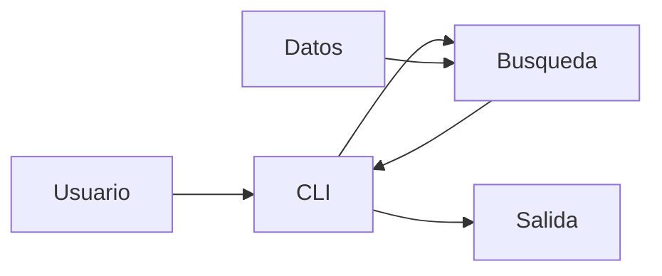

# Architecture

## Overview

CLI local en Python. La entrada se valida y pasa a una función pura de búsqueda sobre registros en memoria.

## Components

- `src/customer_search/models.py`: modelo inmutable `Customer`.
- `src/customer_search/data.py`: datos ficticios de demostración.
- `src/customer_search/search.py`: validación y búsqueda.
- `src/customer_search/cli.py`: argumentos, salida y errores de usuario.
- `tests/`: pruebas unitarias y de CLI.

## Responsibilities

El módulo de búsqueda no imprime ni lee argumentos. La CLI no implementa reglas de coincidencia. Los datos de ejemplo se mantienen separados de ambos.

## Data Flow

La CLI recibe el término, llama a `search_customers(term, customers)`, formatea los resultados y devuelve un código de salida. La función devuelve una lista nueva en el orden original.

## Interfaces

- Python: `search_customers(term: str, customers: Iterable[Customer]) -> list[Customer]`.
- Terminal: `python -m customer_search <término>` con `PYTHONPATH=src` o instalación editable.

## Error Handling

`search_customers` emite `ValueError` si el término es inválido. La CLI lo traduce a mensaje en `stderr` y código 2. La ausencia de coincidencias es una respuesta válida.

## Testing Strategy

`pytest` verifica búsqueda por ambos campos, fragmentos, normalización, orden, no duplicación, salida de la CLI y códigos de salida.

## Dependencies

Python 3.11+ y biblioteca estándar para ejecución; `pytest` para pruebas. No hay red, base de datos ni API de pago.

## Design Decisions

Se usa memoria para mantener la feature pequeña. `casefold()` hace la comparación insensible a mayúsculas. La lista de clientes se inyecta en la función para probar sin depender de los datos de demostración.

## Trade-offs

El recorrido lineal es sencillo y suficiente para el conjunto local; no ofrece indexación ni persistencia. La coincidencia es textual y no implementa búsqueda aproximada ni normalización de acentos.
